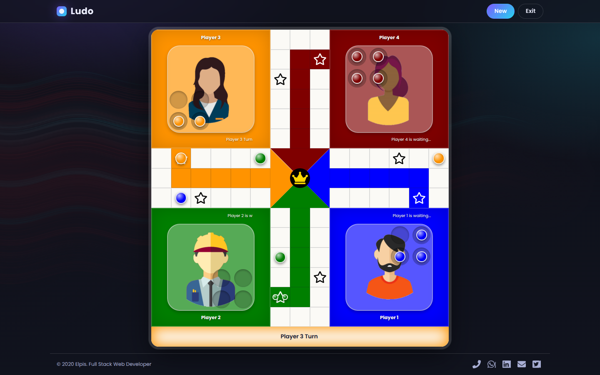

# Ludo

A browser Ludo board game for 2 to 4 players, built with plain HTML, CSS and JavaScript. No build step, no dependencies.



## Features

- 2, 3 or 4 players, each human or computer controlled
- Custom name, avatar and chip colour per player
- Two spinners per turn; use either value or their sum
- Three safe-square rules: Anywhere, Special (star squares) or Nowhere
- Capturing sends rival chips back to their base
- Game saved in your browser; resume with Continue Game
- Responsive down to phone widths, keyboard accessible, respects reduced motion

## Rules in short

1. Roll a 6 on either spinner to bring a chip out of base.
2. Pick a spinner value (or the sum), then click a highlighted chip to move it.
3. Land on a rival chip outside a safe square to send it home.
4. A double (same value on both spinners) gives you another turn.
5. Move all four chips into the centre to win. The game ends when one player is left.

## Run locally

```sh
python3 -m http.server 8000
# open http://localhost:8000
```

Any static file server works.

## Project structure

```
index.html      page markup, SEO metadata
style.css       theme, board and game screens
app.js          game logic and screen flow
base/           shared utilities (app.js), base styles and icon font CSS
images/         avatars, board icons, background, social preview
docs/           plan and README screenshot
manifest.json   web app manifest
```

## License

MIT, see [LICENSE](LICENSE).
